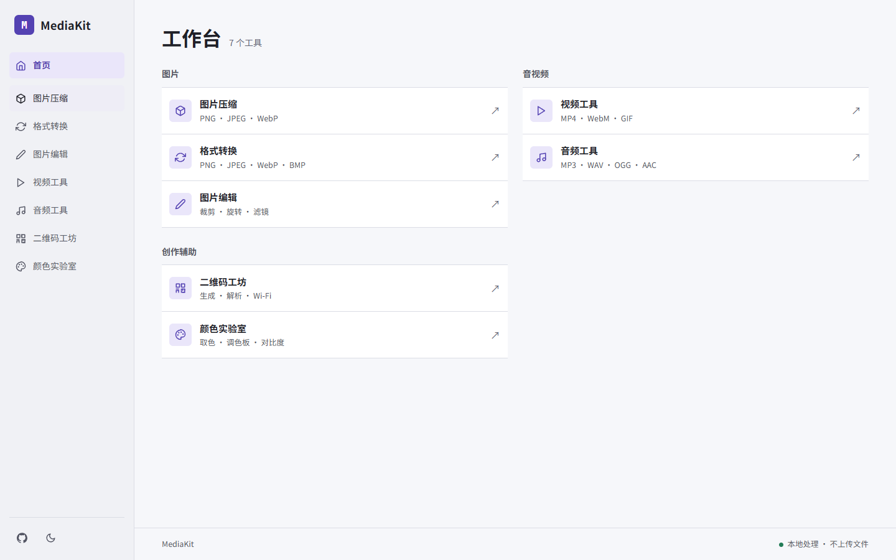
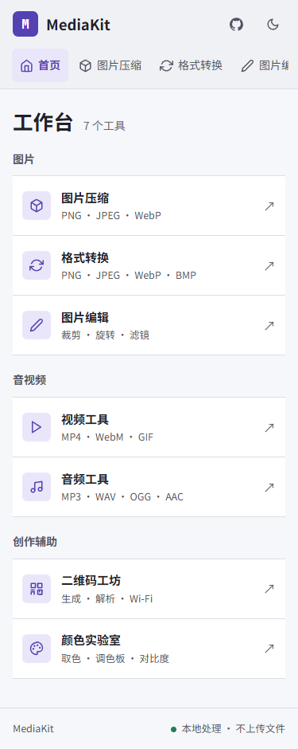

# MediaKit

一个完全在浏览器本地运行的媒体工具箱。用于处理图片、视频、音频、二维码与颜色数据，无需上传文件到服务器。

在线体验：[dvesiz.github.io/mediakit](https://dvesiz.github.io/mediakit/)

## 界面预览

桌面端通过左侧导航切换工具。首页将七个工具分为「图片」「音视频」「创作辅助」三组。



<details>
<summary>查看移动端界面</summary>


</details>

## 功能

| 模块 | 能力 |
| --- | --- |
| 图片压缩 | 压缩 PNG、JPEG、WebP，预览压缩前后效果 |
| 格式转换 | 转换常用图片格式 |
| 图片编辑 | 裁剪、旋转、翻转、缩放与滤镜 |
| 视频工具 | 压缩、缩放、转 GIF、MP4/WebM 格式转换 |
| 音频工具 | 转换 MP3、WAV、OGG、AAC，调整码率与音量 |
| 二维码工坊 | 生成、解析二维码，支持 WiFi 配置与 Logo |
| 颜色实验室 | 图片取色、调色板、HEX/RGB/HSL 转换与对比度检查 |

## 特性

- 所有文件均在浏览器本地处理
- 无账号、无后端、无文件上传
- 支持浅色和深色主题，适配桌面与移动设备
- 文件选择区支持拖拽，也可用键盘打开文件选择器
- 视频和音频处理基于 FFmpeg.wasm

## 本地开发

使用 Node.js 20.19+（20.x）或 22.12+。

```bash
git clone https://github.com/Dvesiz/mediakit.git
cd mediakit
npm ci
npm run dev
```

默认访问 `http://localhost:3000/mediakit/`。

常用命令：

```bash
npm test
npm run build
```

## 技术栈

- Vite + Vanilla JavaScript (ESM)
- Canvas API
- FFmpeg.wasm
- qrcode + jsQR
- Vitest

## 隐私

MediaKit 不会将待处理文件上传到应用服务器。文件仅在当前浏览器会话中读取、处理和下载。

## 开源协议

本项目采用 [MIT License](LICENSE) 开源。你可以自由使用、修改和分发代码，但需保留原始版权和许可声明。
